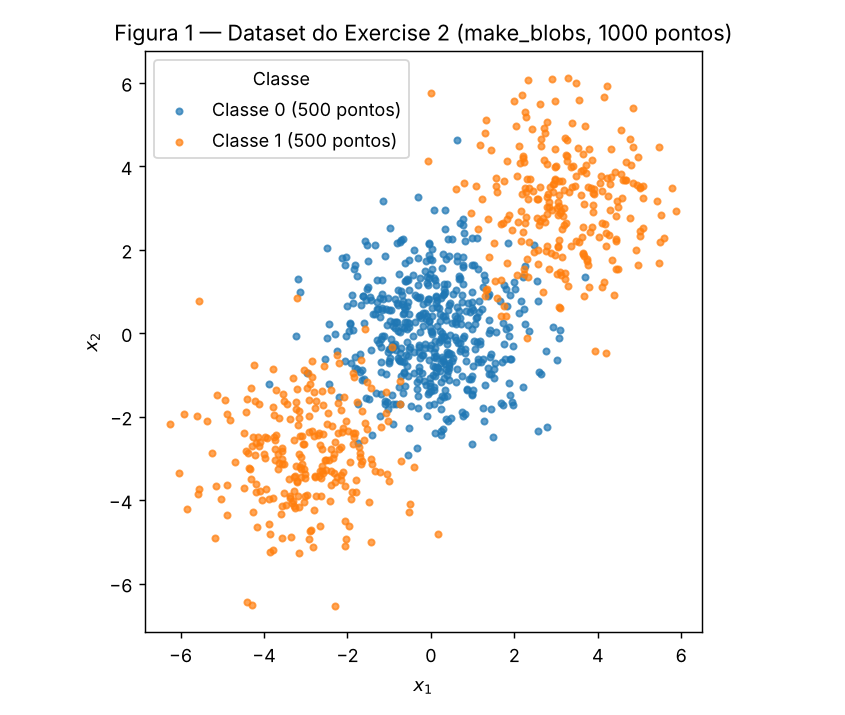
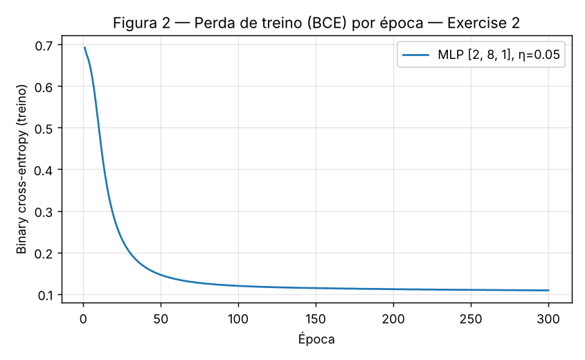
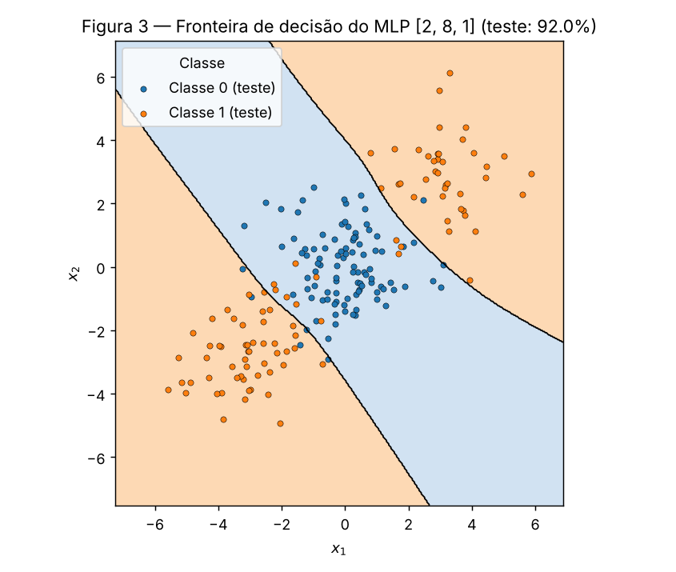
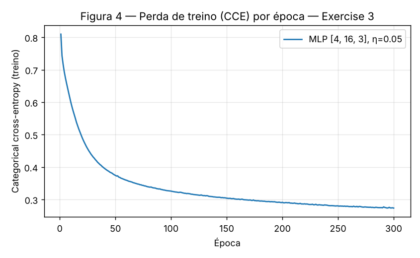
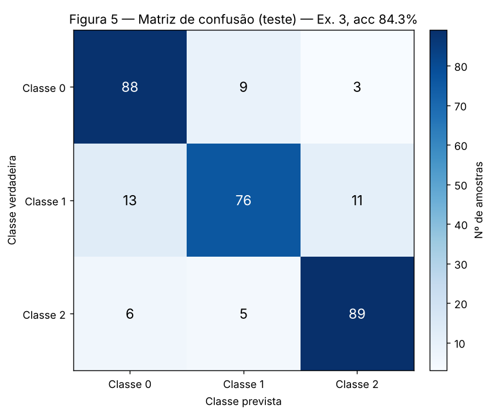
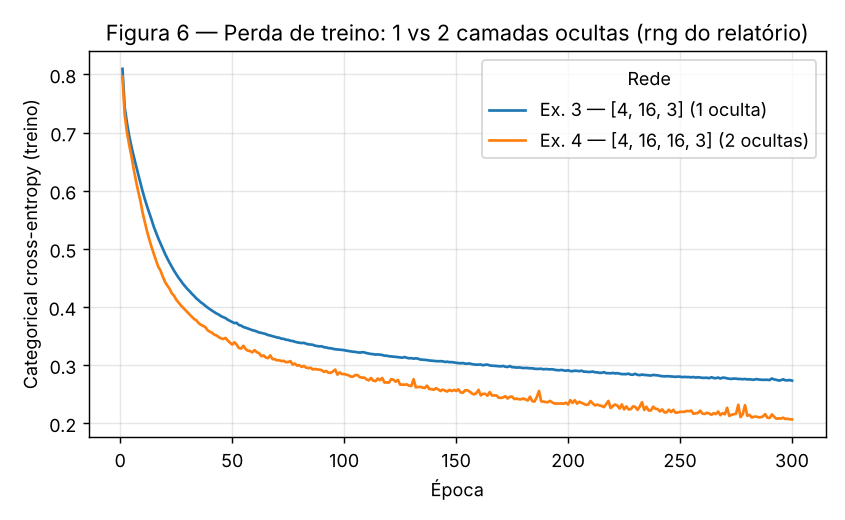

# 3. MLP

!!! abstract "Enunciado"

    [Exercises → MLP](https://insper.github.io/ann-dl/2026.2/exercises/mlp/){:target='_blank'}

**Implementação.** Todo o relatório sai de um único script, `code/mlp_report.py`, que usa
**um único** gerador `rng = np.random.default_rng(42)` do começo ao fim (pesos iniciais e
embaralhamento dos mini-batches dos Ex. 2 → Ex. 3 → Ex. 4). O MLP é **uma classe** escrita à
mão com `numpy` — ativações, perdas, forward, backward e atualização — que recebe a lista de
tamanhos das camadas como argumento. A mesma classe, **sem nenhuma linha alterada**, roda os
Exercises 2, 3 e 4: só mudam os argumentos (`layer_sizes`, `loss`, `lr`).

O scikit-learn aparece apenas onde o enunciado permite: geração dos dados (`make_blobs`,
`make_classification`), split (`train_test_split`), matriz de confusão e o baseline linear
(`LogisticRegression`).

Para reproduzir: `cd docs/exercises/mlp/code && python mlp_report.py` (≈ 25 s). O script
gera as Figuras 1–6 em `figures/` e grava todos os números citados aqui em
`code/results.json`.

??? example "Script completo — `code/mlp_report.py`"

    ``` { .python .copy linenums='1' }
    --8<-- "docs/exercises/mlp/code/mlp_report.py"
    ```

## Exercise 1

**One step of backpropagation, by hand.** Rede 2 → 2 → 1, tanh nas duas camadas, perda
$L = (y-\hat y)^2$ com $N=1$. Valores dados:

$$
x=\begin{bmatrix}0.5\\-0.2\end{bmatrix},\quad y=1.0,\quad
W^{(1)}=\begin{bmatrix}0.3&-0.1\\0.2&0.4\end{bmatrix},\quad
b^{(1)}=\begin{bmatrix}0.1\\-0.2\end{bmatrix},\quad
W^{(2)}=\begin{bmatrix}0.5&-0.3\end{bmatrix},\quad
b^{(2)}=0.2,\quad \eta=0.3
$$

Todas as contas abaixo foram feitas à mão, com 6 casas decimais (o enunciado pede pelo
menos 4). Ao final do item C há uma conferência numérica independente.

### A — Forward pass

**1. Pré-ativações ocultas** $z^{(1)} = W^{(1)}x + b^{(1)}$:

$$
\begin{aligned}
z^{(1)}_1 &= 0.3(0.5) + (-0.1)(-0.2) + 0.1 = 0.15 + 0.02 + 0.1 = \mathbf{0.270000}\\
z^{(1)}_2 &= 0.2(0.5) + 0.4(-0.2) - 0.2 = 0.10 - 0.08 - 0.2 = \mathbf{-0.180000}
\end{aligned}
$$

**2. Ativações ocultas** $h^{(1)} = \tanh(z^{(1)})$:

$$
h^{(1)}_1 = \tanh(0.27) = \mathbf{0.263625},\qquad
h^{(1)}_2 = \tanh(-0.18) = \mathbf{-0.178081}
$$

**3. Pré-ativação da saída** $u^{(2)} = W^{(2)}h^{(1)} + b^{(2)}$:

$$
u^{(2)} = 0.5(0.263625) + (-0.3)(-0.178081) + 0.2 = 0.131812 + 0.053424 + 0.2 = \mathbf{0.385237}
$$

**4. Saída e perda:**

$$
\hat y = \tanh(0.385237) = \mathbf{0.367247},\qquad
L = (1 - 0.367247)^2 = 0.632753^2 = \mathbf{0.400377}
$$

### B — Backward pass

Regra da cadeia de fora para dentro, usando $\frac{d}{du}\tanh(u) = 1-\tanh^2(u)$.

**Início:** $\displaystyle \frac{\partial L}{\partial \hat y} = -2(y-\hat y) = -2(0.632753) = \mathbf{-1.265507}$

**1. Através da tanh de saída:**

$$
\frac{\partial L}{\partial u^{(2)}} = \frac{\partial L}{\partial \hat y}\,(1-\hat y^2)
= -1.265507 \times (1 - 0.134870) = -1.265507 \times 0.865130 = \mathbf{-1.094828}
$$

**2. Camada de saída.** Como $u^{(2)} = \sum_j W^{(2)}_j h^{(1)}_j + b^{(2)}$, temos
$\partial u^{(2)}/\partial W^{(2)}_j = h^{(1)}_j$ e $\partial u^{(2)}/\partial b^{(2)} = 1$:

$$
\begin{aligned}
\frac{\partial L}{\partial W^{(2)}} &= \frac{\partial L}{\partial u^{(2)}}\,h^{(1)\top}
= -1.094828 \times [0.263625,\ -0.178081] = [\mathbf{-0.288624},\ \mathbf{0.194968}]\\
\frac{\partial L}{\partial b^{(2)}} &= \frac{\partial L}{\partial u^{(2)}} = \mathbf{-1.094828}
\end{aligned}
$$

**3. Propagando para a camada oculta.** $\partial u^{(2)}/\partial h^{(1)}_j = W^{(2)}_j$, e
depois a derivada da tanh oculta, com $1-(h^{(1)})^2 = [1-0.069498,\ 1-0.031713] = [0.930502,\ 0.968287]$:

$$
\begin{aligned}
\frac{\partial L}{\partial h^{(1)}} &= \frac{\partial L}{\partial u^{(2)}}\,W^{(2)\top}
= -1.094828 \times [0.5,\ -0.3] = [\mathbf{-0.547414},\ \mathbf{0.328448}]\\
\frac{\partial L}{\partial z^{(1)}} &= \frac{\partial L}{\partial h^{(1)}} \odot \big(1-(h^{(1)})^2\big)
= [-0.547414 \times 0.930502,\ 0.328448 \times 0.968287]\\
&= [\mathbf{-0.509370},\ \mathbf{0.318032}]
\end{aligned}
$$

**4. Camada oculta.** $z^{(1)}_i = \sum_k W^{(1)}_{ik}x_k + b^{(1)}_i$, então
$\partial L/\partial W^{(1)}_{ik} = \frac{\partial L}{\partial z^{(1)}_i}\,x_k$ (produto externo):

$$
\frac{\partial L}{\partial W^{(1)}} = \frac{\partial L}{\partial z^{(1)}}\,x^\top =
\begin{bmatrix}-0.509370(0.5) & -0.509370(-0.2)\\ 0.318032(0.5) & 0.318032(-0.2)\end{bmatrix}
= \begin{bmatrix}\mathbf{-0.254685} & \mathbf{0.101874}\\ \mathbf{0.159016} & \mathbf{-0.063606}\end{bmatrix},
\qquad
\frac{\partial L}{\partial b^{(1)}} = [\mathbf{-0.509370},\ \mathbf{0.318032}]
$$

### C — Parameter update

$\theta \leftarrow \theta - \eta\,\partial L/\partial\theta$ com $\eta = 0.3$. (Contando
entrada a entrada, são **nove** escalares: 4 em $W^{(1)}$, 2 em $b^{(1)}$, 2 em $W^{(2)}$ e 1 em
$b^{(2)}$ — todos atualizados abaixo.)

| Parâmetro | Antes | $-\eta \cdot$ gradiente | Depois |
|---|---|---|---|
| $W^{(2)}_1$ | 0.5 | $-0.3(-0.288624) = +0.086587$ | **0.586587** |
| $W^{(2)}_2$ | −0.3 | $-0.3(0.194968) = -0.058490$ | **−0.358490** |
| $b^{(2)}$ | 0.2 | $-0.3(-1.094828) = +0.328448$ | **0.528448** |
| $W^{(1)}_{11}$ | 0.3 | $-0.3(-0.254685) = +0.076405$ | **0.376405** |
| $W^{(1)}_{12}$ | −0.1 | $-0.3(0.101874) = -0.030562$ | **−0.130562** |
| $W^{(1)}_{21}$ | 0.2 | $-0.3(0.159016) = -0.047705$ | **0.152295** |
| $W^{(1)}_{22}$ | 0.4 | $-0.3(-0.063606) = +0.019082$ | **0.419082** |
| $b^{(1)}_1$ | 0.1 | $-0.3(-0.509370) = +0.152811$ | **0.252811** |
| $b^{(1)}_2$ | −0.2 | $-0.3(0.318032) = -0.095410$ | **−0.295410** |

**A perda desce num segundo forward pass.** Cada parâmetro andou na direção oposta ao seu
gradiente, e a primeira ordem de Taylor dá $\Delta L \approx -\eta\,\lVert\nabla L\rVert^2 =
-0.3 \times 1.785141 = -0.535542 < 0$. Intuitivamente: $\hat y = 0.3672$ estava abaixo de
$y=1$, então $\partial L/\partial u^{(2)} < 0$ e o passo empurra $u^{(2)}$ para cima — o viés
de saída sobe, o peso ligado ao neurônio oculto positivo sobe, e assim por diante. Refazendo
o forward com os parâmetros novos: $\hat y = 0.711180$ e $L = (1-0.711180)^2 = \mathbf{0.083417}$,
uma queda de 0.400377 → 0.083417. A queda real (−0.317) é **menor** que a prevista pela
aproximação linear (que daria perda negativa, impossível): com $\eta=0.3$ o passo já não é
"pequeno", e a curvatura da tanh, que satura perto de 1, freia o ganho.

??? success "Conferência numérica (não substitui a conta acima)"

    ``` { .python .copy linenums='1' title="exercise1() em mlp_report.py" }
    --8<-- "docs/exercises/mlp/code/mlp_report.py:ex1"
    ```

    A saída (`results.json → ex1`) bate com todos os valores da derivação manual nas 6 casas.

## Exercise 2

### A — Generate the data

``` { .python .copy linenums='1' title="Dados do Exercise 2 (mlp_report.py)" }
--8<-- "docs/exercises/mlp/code/mlp_report.py:ex2_data"
```

Split estratificado 80/20: 800 pontos de treino e 200 de teste, 50% de cada classe.


/// caption
**Figura 1** — os 1000 pontos coloridos por `y`. A Classe 0 (500 pontos) é um único blob
em $(0,0)$; a Classe 1 (500 pontos) são dois blobs, em $(3,3)$ e $(-3,-3)$, um de cada lado.
///

### B — Establish the baseline

``` { .python .copy linenums='1' title="Baseline linear (mlp_report.py)" }
--8<-- "docs/exercises/mlp/code/mlp_report.py:ex2_baseline"
```

Acurácia de teste da regressão logística: **47.50%** — pior que chutar a classe majoritária (50%).

### C — Implement the MLP

O MLP fica numa classe que recebe `layer_sizes` (por exemplo `[2, 8, 1]` ou `[4, 16, 16, 3]`).

- **Forward:** em cada camada $U = A_{\text{prev}}W + b$; tanh nas ocultas e, na saída, a
  ativação que acompanha a perda (sigmoid para BCE, softmax para CCE).
- **Perda:** binary cross-entropy $L = -\frac1N\sum_n [y_n\log p_n + (1-y_n)\log(1-p_n)]$.
- **Backward:** na saída $\delta = (P - Y)/N$ (sigmoid + BCE; derivado no Ex. 3.B para o par
  softmax + CCE, que dá a mesma expressão). Em cada camada $\partial L/\partial W = A_{\text{prev}}^\top\delta$,
  $\partial L/\partial b = \sum_n \delta_n$, e o erro desce com
  $\delta_{\text{prev}} = (\delta W^\top) \odot (1 - A_{\text{prev}}^2)$ — exatamente a regra
  do Exercise 1, vetorizada para $N$ amostras.
- **Atualização:** $\theta \leftarrow \theta - \eta\,\partial L/\partial\theta$, em
  mini-batches de 32 embaralhados pelo `rng` a cada época.
- **Inicialização:** Xavier/Glorot normal, $W \sim \mathcal N\!\big(0,\ \tfrac{2}{n_{in}+n_{out}}\big)$, $b=0$.

``` { .python .copy linenums='1' title="O MLP (mlp_report.py)" }
--8<-- "docs/exercises/mlp/code/mlp_report.py:mlp"
```

``` { .python .copy linenums='1' title="Treino do Exercise 2 (mlp_report.py)" }
--8<-- "docs/exercises/mlp/code/mlp_report.py:ex2_train"
```

| Item | Valor |
|---|---|
| Arquitetura | `[2, 8, 1]` — 2 entradas, 1 camada oculta com 8 tanh, 1 saída sigmoid (33 parâmetros) |
| Perda | Binary cross-entropy |
| Taxa de aprendizado | $\eta = 0.05$ |
| Épocas / batch | 300 épocas, mini-batch de 32 |
| Perda final de treino | 0.1088 |
| Acurácia de treino | 96.38% |
| **Acurácia de teste** | **92.00%** |


/// caption
**Figura 2** — BCE no conjunto de treino ao fim de cada época. Cai de 0.69 ($\ln 2$, o valor de
um classificador que diz 50% para tudo) para ~0.15 em 50 épocas e estabiliza em ~0.11.
///


/// caption
**Figura 3** — a rede avaliada numa grade 400×400, com os 200 pontos de teste por cima.
Azul: região prevista como Classe 0; laranja: Classe 1; linha preta: fronteira $p=0.5$.
///

### D — Analysis

A Figura 3 mostra a resposta: a região que a rede atribui à Classe 0 é uma **faixa diagonal**
que passa pela origem, e a Classe 1 recebe as **duas regiões de fora** dessa faixa — uma no
canto superior direito (o blob em $(3,3)$) e outra no inferior esquerdo (o blob em $(-3,-3)$).
A região laranja é, portanto, **desconexa**.

Uma única reta divide o plano em dois semiplanos, e cada semiplano é convexo e conexo. Não há
como pôr $(3,3)$ e $(-3,-3)$ do mesmo lado de uma reta deixando $(0,0)$ — o ponto médio dos
dois — do outro lado: se os dois extremos estão num semiplano, o segmento entre eles também
está, e $(0,0)$ está nesse segmento. Qualquer reta que o modelo linear escolha deixa, então,
pelo menos um dos blobs da Classe 1 do lado "errado".

Por que **abaixo** de 50%? Olhando o que a regressão logística aprendeu, ela essencialmente
desistiu: $w = [0.0296,\ 0.0015]$, $b = -0.0031$, e as probabilidades no teste ficam todas entre
0.457 e 0.544. A fronteira $p=0.5$ é praticamente a reta vertical $x_1 \approx 0$. O motivo é a
simetria: qualquer inclinação que ganhe um blob da Classe 1 perde o outro na mesma medida,
então a log-loss quase não muda e o ótimo é uma rede quase "plana". O que essa reta faz no teste:

| Blob (teste) | Classe | Pontos | Acertos da reta |
|---|---|---|---|
| $(0,0)$ | 0 | 100 | 53 (cortado ao meio) |
| $(3,3)$ | 1 | 42 | 42 (todo do lado "1") |
| $(-3,-3)$ | 1 | 58 | **0** (todo do lado "0") |
| **Total** | | 200 | **95 → 47.5%** |

Ou seja, a reta acerta o blob central pela metade, acerta um blob externo inteiro e **erra o
outro inteiro**. O resultado ficaria em ~50% se os dois blobs externos tivessem o mesmo
tamanho no teste; como o split estratifica por `y` (e não por blob), o blob errado ficou com 58
pontos e o certo com 42, e isso empurra a acurácia para baixo de 50%. É a geometria da Figura 1
em ação: com uma reta, um dos dois blobs da Classe 1 fica obrigatoriamente do lado errado.

A camada oculta resolve isso porque cada um dos 8 neurônios tanh é ele mesmo uma "reta suave";
a camada de saída **combina** essas retas. Duas delas, paralelas à diagonal $x_1+x_2=\text{const}$
e com sinais opostos, já bastam para cercar a faixa central — é exatamente o formato que se vê
na Figura 3 (as duas bordas da faixa são aproximadamente paralelas). Os ~8% de erro que restam
estão onde as nuvens de fato se sobrepõem (`cluster_std=1.2`, a ~4.2 unidades de distância):
pontos laranja dentro da faixa e azuis fora dela, que nenhum classificador separaria sem
decorar ruído.

## Exercise 3

### A — Generate the data

``` { .python .copy linenums='1' title="Dados do Exercise 3 (mlp_report.py)" }
--8<-- "docs/exercises/mlp/code/mlp_report.py:ex3_data"
```

1500 amostras, 4 features informativas, 3 classes com 2 clusters cada; split estratificado
80/20 (1200 treino / 300 teste) com a mesma seed. Os rótulos viram one-hot para a CCE.

### B — Adapt the network

As únicas mudanças em relação ao Exercise 2 são **argumentos**: `layer_sizes` termina em 3
unidades e `loss="cce"`, que liga a saída **softmax** e a **categorical cross-entropy**
$L = -\frac1N\sum_n\sum_k y_{nk}\log p_{nk}$. Forward, backward e `step` são exatamente as
mesmas linhas do Ex. 2 (é a mesma classe `MLP`).

**Derivação de $\partial L/\partial u$ para softmax + CCE.** Para uma amostra, com
$p_k = e^{u_k}/\sum_j e^{u_j}$ e $L = -\sum_k y_k\log p_k$ ($y$ one-hot).

*Jacobiano da softmax.* Derivando o quociente:

$$
\frac{\partial p_k}{\partial u_j} =
\begin{cases} p_k(1-p_k) & k=j\\ -p_kp_j & k\neq j\end{cases}
\;=\; p_k(\delta_{kj} - p_j)
$$

*Regra da cadeia.* Como $\partial L/\partial p_k = -y_k/p_k$:

$$
\frac{\partial L}{\partial u_j} = \sum_k \frac{\partial L}{\partial p_k}\frac{\partial p_k}{\partial u_j}
= \sum_k -\frac{y_k}{p_k}\,p_k(\delta_{kj}-p_j)
= -\sum_k y_k\delta_{kj} + p_j\sum_k y_k
= -y_j + p_j\cdot 1
$$

$$
\boxed{\;\frac{\partial L}{\partial u} = p - y\;}
\qquad\text{(e } (P-Y)/N \text{ com a média sobre o batch)}
$$

**Por que é tão simples.** Dois motivos se somam. (i) O $\log$ da CCE desfaz a exponencial da
softmax: o $1/p_k$ de $\partial L/\partial p_k$ cancela exatamente o fator $p_k$ do jacobiano,
então não sobra nenhum termo de saturação — ao contrário do Ex. 1, onde o $(1-\hat y^2)$ da
tanh multiplica o gradiente e o encolhe quando a saída satura. (ii) $\sum_k y_k = 1$, o que
junta os termos cruzados num só $p_j$. O resultado tem leitura direta: o sinal de erro de
cada unidade é "probabilidade prevista menos alvo". O mesmo vale para sigmoid + BCE
($\sigma'(u) = \sigma(1-\sigma)$ cancela com o denominador da BCE e dá $p-y$) — e é por isso
que **uma única linha** `delta = (self.A[-1] - Y) / N` serve aos Exercises 2, 3 e 4 sem
mudança, o que caracteriza o reuso literal pedido no item extra.

### C — Train and evaluate

``` { .python .copy linenums='1' title="Treino do Exercise 3 (mlp_report.py)" }
--8<-- "docs/exercises/mlp/code/mlp_report.py:ex3_train"
```

| Item | Valor |
|---|---|
| Arquitetura | `[4, 16, 3]` — 4 entradas, 1 camada oculta com 16 tanh, 3 saídas softmax (131 parâmetros) |
| Perda | Categorical cross-entropy |
| Taxa de aprendizado | $\eta = 0.05$ |
| Épocas / batch | 300 épocas, mini-batch de 32 |
| Perda final de treino | 0.2734 |
| Acurácia de treino | 89.83% |
| **Acurácia de teste** | **84.33%** (253 / 300) |
| Baseline (regressão logística) | 66.33% |


/// caption
**Figura 4** — CCE no conjunto de treino por época. Parte de ~0.81 e ainda desce
lentamente ao fim das 300 épocas (0.273).
///


/// caption
**Figura 5** — matriz de confusão no teste (100 amostras por classe). Linhas: classe
verdadeira; colunas: classe prevista.
///

### D — Analysis

**Par mais confundido: Classes 0 e 1** — 9 amostras da Classe 0 previstas como 1 e 13 da
Classe 1 previstas como 0, **22 erros** no total, contra 16 para o par 1–2 e 9 para o par 0–2.
A Classe 1 é a pior (76% de recall) porque perde amostras para os **dois** lados.

**Explicação pela estrutura dos clusters.** O `make_classification` coloca os 6 clusters
gaussianos em vértices de um hipercubo 4D de lado $2\cdot\texttt{class\_sep}=2$ e atribui o
cluster $k$ à classe $k \bmod 3$. Como ele gera tudo em ordem de cluster e só embaralha no
fim, regerando com `shuffle=False` recuperei de qual cluster veio **cada** amostra:

``` { .python .copy linenums='1' title="Recuperando o cluster de cada amostra (mlp_report.py)" }
--8<-- "docs/exercises/mlp/code/mlp_report.py:ex3_clusters"
```

Distâncias entre os centróides empíricos (C$k$ = cluster $k$, classe entre parênteses):

| | C0 (0) | C1 (1) | C2 (2) | C3 (0) | C4 (1) | C5 (2) |
|---|---|---|---|---|---|---|
| **C0 (0)** | — | **2.03** | 2.96 | 3.42 | 3.59 | 3.41 |
| **C1 (1)** | **2.03** | — | **2.08** | 3.95 | 2.65 | 2.67 |
| **C2 (2)** | 2.96 | **2.08** | — | 3.51 | **1.92** | 3.54 |
| **C3 (0)** | 3.42 | 3.95 | 3.51 | — | 3.02 | 3.03 |
| **C4 (1)** | 3.59 | 2.65 | **1.92** | 3.02 | — | 2.94 |
| **C5 (2)** | 3.41 | 2.67 | 3.54 | 3.03 | 2.94 | — |

Vértices vizinhos no hipercubo (diferem em uma só coordenada) ficam a distância ≈ 2; os
demais, a ≥ 2.8. Só **três** pares de clusters de classes diferentes são vizinhos (em negrito):
**C0–C1** (classes 0–1), **C1–C2** e **C2–C4** (ambos classes 1–2). Com cada cluster tendo raio
RMS de ~1.8–2.7, os vizinhos se sobrepõem bastante — é nessas arestas que os erros se
concentram:

- dos 22 erros 0↔1, **16 são de pontos dos clusters C0 e C1** (7 de C0 previstos como 1, 9 de C1 previstos como 0) — a aresta C0–C1;
- C1 sozinho responde por 17 dos 47 erros do teste: ele é vizinho de um cluster da Classe 0
  **e** de um da Classe 2, então é "espremido" pelos dois lados (9 erros para 0, 8 para 2);
- o par 0–2 não tem nenhuma aresta (menor distância 2.96) e é o menos confundido (9 erros).

Por que 0–1 e não 1–2, se 1–2 tem duas arestas? Porque C0 e C1 são os dois clusters mais
espalhados do dataset (raios RMS 2.54 e 2.72, contra 1.81 de C4), então a sobreposição ao
longo daquela aresta é maior. Há ainda um piso de ruído: `flip_y=0.01` (padrão) trocou o
rótulo de 11 das 1500 amostras ao acaso, erros que nenhum modelo acerta.

**O que a camada oculta acrescentou.** A regressão logística chega a **66.33%** no teste,
contra **84.33%** do MLP (+18.0 p.p.). Cada classe é a união de dois vértices **não
adjacentes** do hipercubo; uma fronteira linear por classe (o que a regressão logística
multinomial faz) não consegue isolar dois vértices distantes sem engolir os que estão no
caminho. A matriz de confusão do baseline mostra isso: a Classe 1 — cujos dois clusters, C1 e C4, são
ambos vizinhos de C2 — cai para 57% de recall, e 32 amostras dela vão para a Classe 2.
Os 16 neurônios ocultos dão à rede várias "retas" para combinar, e com elas ela recorta cada
classe como uma região não convexa formada por dois pedaços.

## Exercise 4

### A — Train the deeper network

Mesmos dados e split do Ex. 3, mesmo $\eta = 0.05$, mesmas 300 épocas, mesmo batch de 32, o
mesmo `rng` do relatório (na sequência do Ex. 3) e a mesma classe `MLP`. A única mudança é a
lista de camadas:

``` { .python .copy linenums='1' title="Treino do Exercise 4 (mlp_report.py)" }
--8<-- "docs/exercises/mlp/code/mlp_report.py:ex4_train"
```

- **Arquitetura:** `[4, 16, 16, 3]` — duas camadas ocultas de 16 tanh (403 parâmetros, 3.1× o Ex. 3).
- **Acurácia de teste (rng do relatório):** **83.00%**, contra 84.33% do Ex. 3 na mesma execução.

### B — Compare


/// caption
**Figura 6** — CCE de treino por época das duas redes, mesmos dados, $\eta$, épocas e batch.
A rede de 2 camadas ocultas termina com perda de treino bem menor (0.207 vs 0.273).
///

Um resultado só pode ser sorte de inicialização. Por isso as duas redes foram treinadas com
**5 seeds** (0–4); em cada seed as duas recebem um gerador novo com a mesma seed, para que a
única diferença seja a profundidade:

``` { .python .copy linenums='1' title="Comparação em várias seeds (mlp_report.py)" }
--8<-- "docs/exercises/mlp/code/mlp_report.py:ex4_seeds"
```

| | hidden layers | parameters | final train loss | test accuracy |
|---|---|---|---|---|
| Exercise 3 | 1 | 131 | 0.2791 ± 0.0099 | 85.53% ± 0.93 |
| Exercise 4 | 2 | 403 | 0.2104 ± 0.0097 | 86.07% ± 1.76 |

<small>Média ± desvio-padrão sobre as seeds 0, 1, 2, 3, 4.</small>

| Seed | Ex. 3 — teste | Ex. 4 — teste | Diferença (Ex. 4 − Ex. 3) |
|---|---|---|---|
| 0 | 87.33% | 85.33% | −2.00 p.p. |
| 1 | 84.67% | 85.67% | +1.00 p.p. |
| 2 | 85.33% | 89.00% | +3.67 p.p. |
| 3 | 85.00% | 86.67% | +1.67 p.p. |
| 4 | 85.33% | 83.67% | −1.67 p.p. |
| **Média** | **85.53%** | **86.07%** | **+0.53 p.p.** |

### C — Analysis

**O que medi.** A segunda camada oculta **não trouxe ganho confiável** de acurácia de teste:
+0.53 p.p. na média de 5 seeds, o que equivale a **1.6 amostras** num teste de 300 — bem
dentro da variação entre seeds (a diferença troca de sinal: 3 seeds a favor, 2 contra, indo
de −2.0 a +3.7 p.p.). Na execução com o `rng` do relatório a rede profunda ficou até **atrás**
(83.00% vs 84.33%). A rede de 2 camadas também é menos estável: desvio-padrão de 1.76 p.p.
contra 0.93 p.p.

**A perda de treino conta outra história.** Ela cai consistentemente com a profundidade
(0.279 → 0.210 em média; Figura 6), e a acurácia de **treino** sobe de 89.7% para 92.3%. Só que
o teste não acompanha: a distância treino–teste passa de ~4.2 p.p. para ~6.2 p.p. Os 272
parâmetros extras estão sendo gastos para ajustar melhor o **treino** — inclusive pontos nas
regiões de sobreposição e os rótulos trocados pelo `flip_y` — e não para aprender estrutura
que generalize.

**Por que a profundidade não paga aqui.** O dataset tem só 6 clusters gaussianos em vértices
de um hipercubo 4D, e cada classe é a união de dois deles. A fronteira necessária é
"recortar alguns blobs", algo que uma camada oculta com 16 neurônios já representa bem
(cada neurônio é um hiperplano; a saída combina as regiões). O que limita a acurácia não é
capacidade, mas a **sobreposição** entre clusters vizinhos (as arestas C0–C1, C1–C2, C2–C4 do
Ex. 3.D) e o ruído de rótulo: o erro restante é praticamente irredutível, e nenhuma
arquitetura o remove. Em termos de representação, a segunda camada permite compor
features — combinar hiperplanos em regiões e depois combinar regiões —, mas não há
hierarquia a compor quando a estrutura é "6 blobs". Em termos de otimização, ela custa:
3× mais parâmetros com os mesmos 1200 exemplos, uma superfície de perda mais irregular
(a curva laranja da Figura 6 é visivelmente mais ruidosa) e mais sensibilidade à inicialização.

**Que dado faria a profundidade valer a pena.** Dados com estrutura **composicional e
hierárquica**, em que a fronteira é uma função de funções: imagens (bordas → texturas →
partes → objetos), áudio, texto; ou, em tabelas, problemas do tipo paridade/XOR de muitas
variáveis, espirais entrelaçadas, ou tabuleiros de xadrez com muitas células — fronteiras que
uma rede rasa só aproxima com um número exponencial de neurônios, mas que uma rede profunda
monta reutilizando features intermediárias. Também ajudaria ter **muito mais exemplos**, para
que a capacidade extra fosse usada em estrutura real e não em sobreajuste.

## Results summary

| # | Quantity | Value |
|---|---|---|
| 1 | Ex. 1 — $z^{(1)}$ and $h^{(1)}$ | $z^{(1)} = [0.270000,\ -0.180000]$; $h^{(1)} = [0.263625,\ -0.178081]$ |
| 2 | Ex. 1 — $u^{(2)}$, $\hat y$ and $L$ | $u^{(2)} = 0.385237$; $\hat y = 0.367247$; $L = 0.400377$ |
| 3 | Ex. 1 — the updated parameters | $W^{(1)} = \begin{bmatrix}0.376405 & -0.130562\\ 0.152295 & 0.419082\end{bmatrix}$; $b^{(1)} = [0.252811,\ -0.295410]$; $W^{(2)} = [0.586587,\ -0.358490]$; $b^{(2)} = 0.528448$ (perda no 2º forward: 0.083417, desce) |
| 4 | Ex. 2 — linear baseline test accuracy | 47.50% |
| 5 | Ex. 2 — architecture and test accuracy | `[2, 8, 1]` (tanh / sigmoid, BCE, η = 0.05, 300 épocas) — **92.00%** |
| 6 | Ex. 3 — architecture and test accuracy | `[4, 16, 3]` (tanh / softmax, CCE, η = 0.05, 300 épocas) — **84.33%** (baseline 66.33%) |
| 7 | Ex. 3 — most-confused class pair | Classes **0 e 1** (22 erros: 9 + 13) |
| 8 | Ex. 4 — architecture and test accuracy | `[4, 16, 16, 3]` — **83.00%** (rng do relatório); 86.07% em média nas seeds 0–4 |
| 9 | Ex. 4 — accuracy difference against Ex. 3 (mean over ≥ 3 seeds) | **+0.53 p.p.** (86.07% vs 85.53%, 5 seeds) — dentro do ruído entre seeds |
