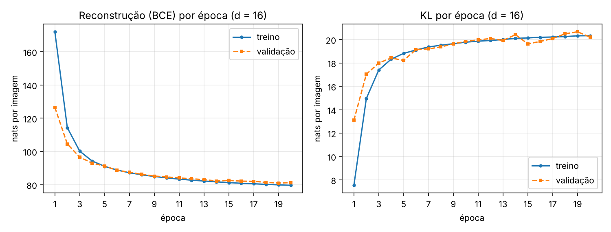
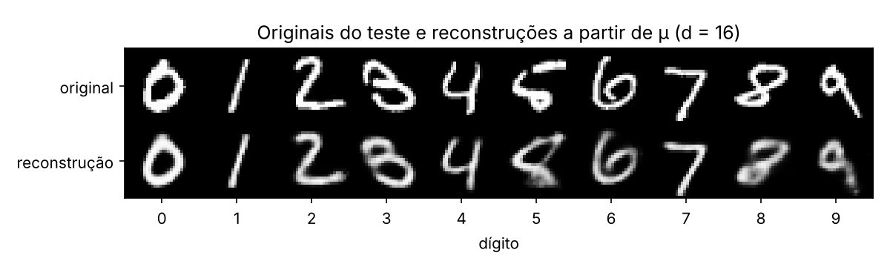
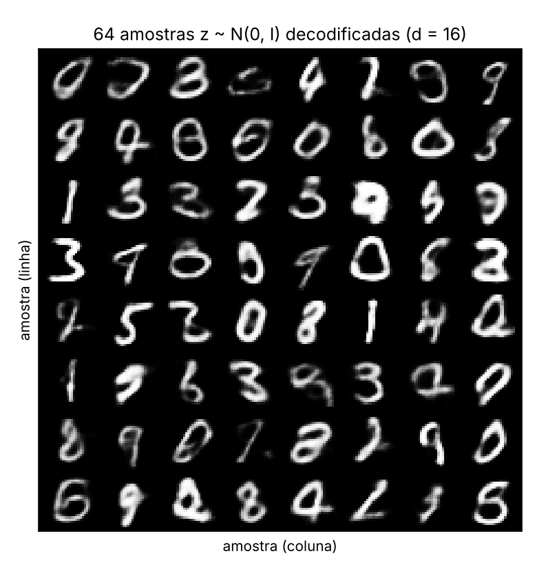
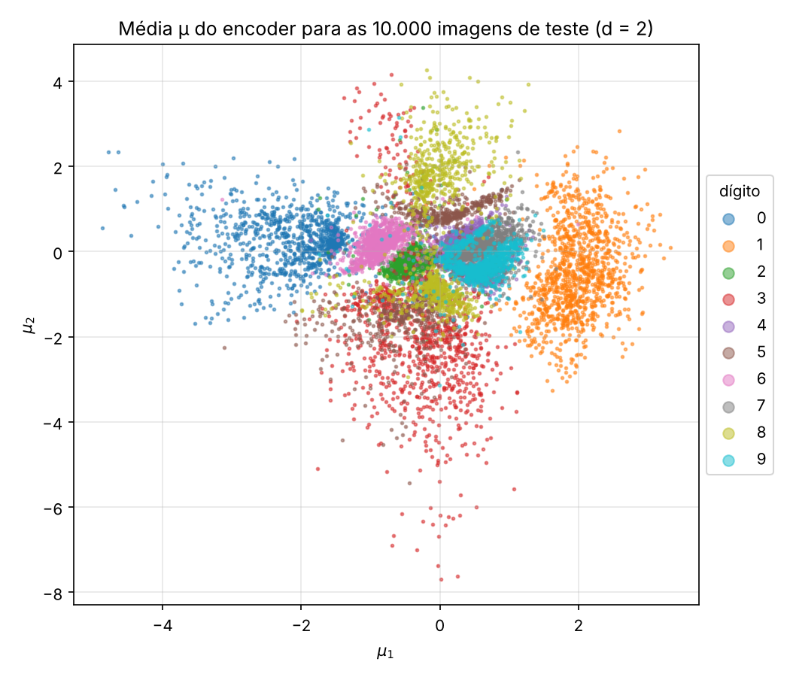
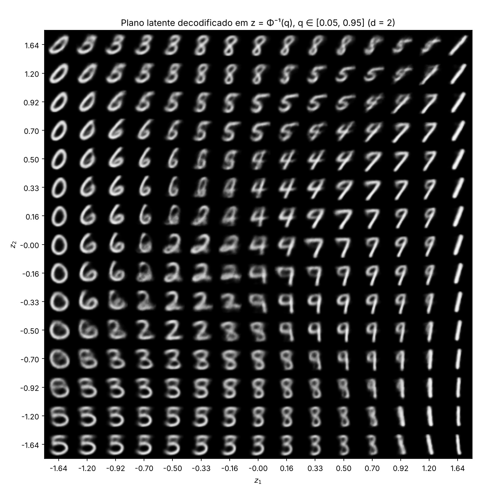
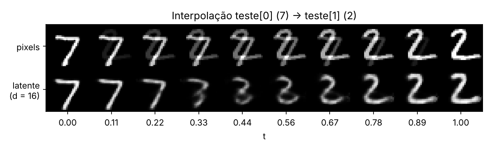

# 4. VAE

!!! abstract "Enunciado"

    [Exercises → VAE](https://insper.github.io/ann-dl/2026.2/exercises/vae/){:target='_blank'}

**Como está organizado.** Tudo sai de um único script, `code/vae_report.py`. Ele treina os
dois modelos, gera as Figuras 1–6 em `figures/` e grava todos os números que aparecem aqui
em `code/results.json`. Pra reproduzir: `cd docs/exercises/vae/code && python vae_report.py`
(uns 4 minutos na CPU; o MNIST é baixado na primeira execução para `code/data/`, que fica
fora do Git).

O PyTorch entra com autograd, `nn.Linear` e Adam, como o enunciado permite. As partes que
são o VAE de fato eu escrevi à mão: a reparametrização, os dois termos da perda (a KL em
forma fechada, sem `torch.distributions`) e a amostragem do prior. Nenhuma classe de VAE de
biblioteca foi usada. Chamo `torch.manual_seed(42)` antes de construir cada modelo, e o
conjunto de teste só é tocado depois que o treino acaba.

Todos os valores de perda estão em **nats por imagem**: soma nos 784 pixels (ou nas $d$
dimensões latentes, no caso da KL) e média sobre as imagens.

??? example "Script completo — `code/vae_report.py`"

    ``` { .python .copy linenums='1' }
    --8<-- "docs/exercises/vae/code/vae_report.py"
    ```

## Exercise 1

### A — Carregando e separando os dados

Uso exatamente a chamada do enunciado: 50.000 imagens de treino e 10.000 de validação,
sorteadas com o gerador de seed 42. As 10.000 imagens oficiais de teste ficam guardadas até
o fim. `ToTensor()` já entrega os pixels em $[0, 1]$, e `flat()` transforma cada imagem num
vetor de 784 posições na entrada do modelo.

``` { .python .copy }
--8<-- "docs/exercises/vae/code/vae_report.py:data"
```

### B — O modelo

Encoder 784 → 512 → 256 com ReLU, duas cabeças lineares 256 → $d$ (uma para $\mu$, outra
para $\log\sigma^2$) e decoder $d$ → 256 → 512 → 784 com sigmoid na saída. Aqui $d = 16$ e
$\beta = 1$.

A amostragem usa o truque da reparametrização, $z = \mu + \sigma \odot \varepsilon$ com
$\varepsilon \sim \mathcal N(0, I)$. Toda a aleatoriedade fica em $\varepsilon$, e o
gradiente passa por $\mu$ e $\sigma$ sem problema. A perda por imagem é

$$
\mathcal L(x) =
\underbrace{-\sum_{j=1}^{784}\Big[x_j\log\hat x_j + (1-x_j)\log(1-\hat x_j)\Big]}_{\text{reconstrução (BCE)}}
\;+\;
\underbrace{\tfrac12\sum_{k=1}^{d}\Big(\mu_k^2 + \sigma_k^2 - 1 - \log\sigma_k^2\Big)}_{\mathrm{KL}\left(\mathcal N(\mu,\sigma^2)\,\|\,\mathcal N(0,I)\right)}
$$

Os dois termos são calculados separados e divididos pelo tamanho do batch, com
`reduction="sum"` na BCE (nunca `"mean"`, que dividiria também por 784 e desequilibraria
os termos).

``` { .python .copy }
--8<-- "docs/exercises/vae/code/vae_report.py:model"
```

### C — Treino

Adam com taxa de aprendizado $10^{-3}$, batch de 128 e 20 épocas. A cada época registro
reconstrução e KL separadas, tanto a média do treino quanto a da validação.

``` { .python .copy }
--8<-- "docs/exercises/vae/code/vae_report.py:train"
```


/// caption
**Figura 1** — Os dois termos da perda ao longo das 20 épocas ($d = 16$). A reconstrução
despenca nas primeiras épocas, enquanto a KL sobe de 7,5 para ~20 nats e estabiliza.
///

As curvas de treino e validação andam praticamente juntas, então não vi sinal de
overfitting em 20 épocas. Na época 1 a validação aparece *melhor* que o treino, mas isso é
só efeito de medida: o treino é a média ao longo da época, com o modelo ainda péssimo nos
primeiros batches, e a validação é medida no fim dela.

Só depois do treino avaliei o conjunto de teste:

``` { .python .copy }
--8<-- "docs/exercises/vae/code/vae_report.py:ex1_test"
```

| Teste ($d = 16$) | nats por imagem |
|---|---|
| Reconstrução | **80,81** |
| KL | **20,25** |
| ELBO negativo (soma) | **101,06** |

Bate com a referência do enunciado (~81 e ~20).

### D — Reconstruções e amostras

Para a Figura 2 peguei a primeira imagem de teste de cada dígito (índices 3, 2, 1, 18, 4,
8, 11, 0, 61 e 7, do 0 ao 9) e decodifiquei a média $\mu$ do encoder. Para a Figura 3
sorteei 64 vetores $z \sim \mathcal N(0, I)$ logo depois de `torch.manual_seed(0)`.

``` { .python .copy }
--8<-- "docs/exercises/vae/code/vae_report.py:ex1_figs"
```


/// caption
**Figura 2** — Em cima, a primeira imagem de teste de cada dígito; embaixo, a reconstrução
a partir de $\mu$ ($d = 16$).
///


/// caption
**Figura 3** — 64 amostras $z \sim \mathcal N(0, I)$ decodificadas pelo modelo $d = 16$.
///

As reconstruções são reconhecíveis, só um pouco mais borradas. O 5 e o 8 são os que mais
sofrem: o 5 do teste é bem esquisito, e o modelo puxa ele para algo entre 5 e 8. As
amostras do prior são outra história. Tem muito dígito bom, mas também vários híbridos
(meio 2, meio 0; meio 4, meio 9) e alguns borrões que não são dígito nenhum.

### E — Análise

**1. Por que a KL sobe enquanto a perda total cai?** No começo o encoder ainda não aprendeu
nada útil: devolve $\mu \approx 0$ e $\log\sigma^2 \approx 0$ para qualquer imagem, então
$q(z\mid x)$ é praticamente o próprio prior e a KL é baixa. Só que um código igual para
todas as imagens não carrega informação, e a reconstrução é péssima (172 nats na época 1).
Para reconstruir melhor, o encoder precisa espalhar as médias e encolher as variâncias, e
cada uma dessas coisas afasta a posterior do prior e paga KL. É uma troca que compensa: da
época 1 para a 20, a reconstrução de treino caiu ~92 nats (172,0 → 79,6) enquanto a KL
subiu só ~13 (7,5 → 20,3). Cada nat de KL "gasto" compra bem mais de um nat de
reconstrução, por isso a soma cai. Depois de umas 8 épocas a KL praticamente estabiliza:
ali o modelo achou o ponto de equilíbrio.

**2. Por que a Figura 3 fica pior que a Figura 2?**

- *Onde as amostras caem.* A KL empurra cada $q(z\mid x)$ para perto de $\mathcal N(0, I)$,
  mas não obriga a união de todas elas (a posterior agregada) a cobrir o prior inteiro.
  Sobram buracos e regiões entre grupos de dígitos onde nenhuma imagem de treino foi
  codificada. Uma reconstrução sempre parte de um $\mu$ que veio de uma imagem real, então
  cai numa região que o decoder conhece. Uma amostra do prior pode cair num desses buracos,
  e o decoder nunca foi treinado ali. Daí os híbridos e os borrões.
- *O que o decoder devolve para um $z$.* A saída é a média de uma Bernoulli por pixel, não
  uma imagem amostrada. Quando um mesmo $z$ é compatível com vários traços diferentes, o
  decoder devolve a *média* deles, que é exatamente o que minimiza a BCE. Média de traços
  diferentes vira cinza e borrado. Para um $\mu$ vindo de uma imagem real essa incerteza é
  pequena; para um $z$ aleatório, longe dos dados, ela é grande, e a média fica mais
  fantasmagórica.

**3. Por que decodificar $\mu$ e não um $z$ amostrado na Figura 2?** Porque $\mu$ é o código
mais provável daquela imagem, o centro da posterior. Um $z$ sorteado soma ruído de
tamanho $\sigma$ e pode escorregar para a borda da região daquele dígito: a reconstrução
sairia um pouco pior e mudaria a cada execução. Decodificando $\mu$, a figura mostra de
forma determinística o que o modelo de fato guardou sobre a imagem, separando isso do ruído
de amostragem (que é justamente o assunto da Figura 3).

## Exercise 2

### A — VAE com $d = 2$

Mesmo modelo, mesmos dados, mesma seed, $\beta = 1$ e o mesmo orçamento (Adam,
$10^{-3}$, batch 128, 20 épocas). A única mudança é `train_vae(2)` no lugar de
`train_vae(16)`.

| Teste | $d = 16$ | $d = 2$ |
|---|---|---|
| Reconstrução | 80,81 | **136,29** |
| KL | 20,25 | **6,75** |
| ELBO negativo | 101,06 | **143,04** |

De novo dentro do esperado (~135 e ~7). Com só duas dimensões o modelo gasta bem menos KL
(não tem onde guardar informação), mas a reconstrução piora 55 nats por imagem.

### B — O conjunto de teste codificado


/// caption
**Figura 4** — Média $\mu$ do encoder ($d = 2$) para as 10.000 imagens de teste, colorida
pelo dígito verdadeiro.
///

Alguns dígitos ganham território próprio: o 0 à esquerda, o 1 à direita, o 3 se esticando
para baixo, o 8 para cima, o 6 entre o 0 e o centro. Mas o miolo, perto da origem, é um
amontoado.

### C — O plano decodificado

``` { .python .copy }
--8<-- "docs/exercises/vae/code/vae_report.py:ex2_grid"
```


/// caption
**Figura 5** — Imagens decodificadas numa grade 15 × 15 em $z = \Phi^{-1}(q)$, com $q$
indo de 0,05 a 0,95 nos dois eixos. A orientação é a mesma da Figura 4 ($z_1$ cresce para a
direita, $z_2$ para cima).
///

**Por que esse espaçamento?** Como $\Phi$ leva cada eixo da normal padrão para uma
distribuição uniforme, pontos igualmente espaçados em $q$ separam fatias com a mesma
probabilidade em cada eixo, e, sendo os eixos independentes sob o prior, toda célula da
grade fica com a mesma massa de probabilidade (por isso o centro, onde o prior se concentra,
é amostrado mais densamente que as bordas).

### D — Interpolação

Escolhi as duas primeiras imagens do teste: **índice 0 (um 7)** e **índice 1 (um 2)**. Com
$t$ em 10 valores igualmente espaçados de 0 a 1, a linha de cima mistura os pixels,
$(1-t)\,x_a + t\,x_b$, e a de baixo mistura as médias no espaço latente do modelo
**$d = 16$ do Exercise 1**, decodificando $(1-t)\,\mu_a + t\,\mu_b$.

``` { .python .copy }
--8<-- "docs/exercises/vae/code/vae_report.py:ex2_interp"
```


/// caption
**Figura 6** — Interpolação de teste[0] (7) para teste[1] (2). Em cima, nos pixels; embaixo,
no espaço latente do modelo $d = 16$.
///

### E — Análise

**1. Quais dígitos se sobrepõem?** O caso mais claro na Figura 4 é o trio **4, 7 e 9**: os
pontos roxos, cinzas e ciano ocupam praticamente a mesma mancha, à direita da origem (em
torno de $\mu \approx (0{,}5;\, 0)$). Também tem bastante mistura entre **3, 5 e 8**, um
pouco abaixo do centro. Na Figura 5 essa transição aparece na faixa $z_1$ entre 0 e 0,7,
$z_2$ entre 0 e 0,7. Andando por ali, um 4 aberto vai fechando a parte de cima e vira um 9;
o laço do 9 vai achatando até virar a barra horizontal do 7. As imagens no meio do caminho
são exatamente isso, 4 com a perna fechando ou 9 com a cabeça reta: formas que passariam
por qualquer um dos três. Faz sentido: esses dígitos compartilham uma haste vertical do lado
direito e só diferem na parte de cima, e com dois números por imagem o modelo não tem como
separar isso com folga.

**2. O que dois números por imagem obrigam o modelo a jogar fora?** Basicamente tudo que
não é "qual dígito é e qual sua inclinação geral". Na Figura 5 cada região do plano
corresponde a um dígito num estilo só: um 0 redondo e meio inclinado, um 1 em pé, um 5 de
um único jeito. Espessura do traço, detalhes como o "pé" do 1 ou o corte no 7, variações
pequenas de forma, tudo isso some. Os dígitos são uma espécie de média de como cada um
costuma ser escrito, e são visivelmente mais borrados que as reconstruções de $d = 16$. Os
números confirmam: a reconstrução de teste sobe de 80,8 para 136,3 nats por imagem (+55,5),
enquanto a KL cai de 20,3 para 6,8. Comprimir para 2 dimensões economiza ~13,5 nats de KL,
mas custa 55 de reconstrução, e o ELBO negativo piora de 101,1 para 143,0. É informação
sobre o estilo de escrita que simplesmente não cabe no código.

**3. As duas linhas da Figura 6.** A linha latente é a que passa por imagens com cara de
dígito. Cada quadro tem um traço único e contínuo: o 7 vai encolhendo a barra, passa por
algo parecido com um 3 por volta de $t \approx 0{,}4$ e chega num 2. A transição no meio
fica mais apagada e borrada (o ponto médio entre dois códigos cai numa região menos
povoada), mas em nenhum momento são dois desenhos sobrepostos. A linha de pixels é só um
*cross-fade*: em $t \approx 0{,}5$ tem um 7 e um 2 inteiros, cada um com metade do brilho,
um por cima do outro. Isso acontece porque o conjunto das imagens de dígitos não é convexo
no espaço de pixels: a média de dois dígitos válidos não é um dígito. Já o espaço latente
foi treinado para que pontos próximos decodifiquem imagens plausíveis, então uma reta em
$z$ vira um caminho curvo *sobre* a variedade dos dígitos, e o decoder transforma esse
caminho em imagens de verdade.

## Results summary

| # | Quantidade | Valor |
|---|---|---|
| 1 | Ex. 1: teste — reconstrução, KL e ELBO negativo ($d = 16$) | 80,81 · 20,25 · 101,06 nats por imagem |
| 2 | Ex. 1: KL de validação na primeira e na última época | 13,10 → 20,21 nats por imagem |
| 3 | Ex. 2: teste — reconstrução e KL ($d = 2$) | 136,29 · 6,75 nats por imagem |
| 4 | Ex. 2: índices de teste interpolados | 0 (dígito 7) e 1 (dígito 2) |
