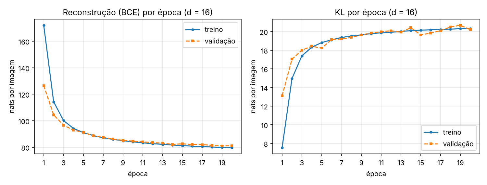
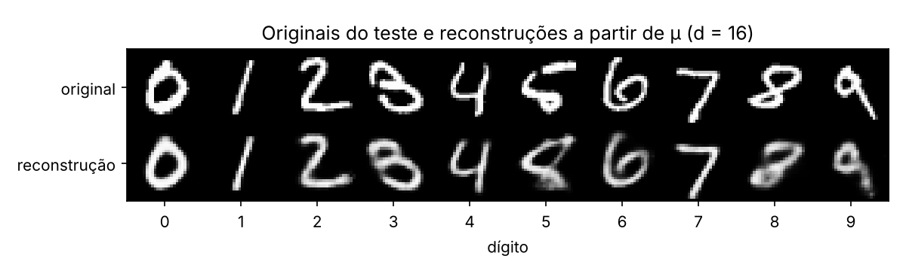
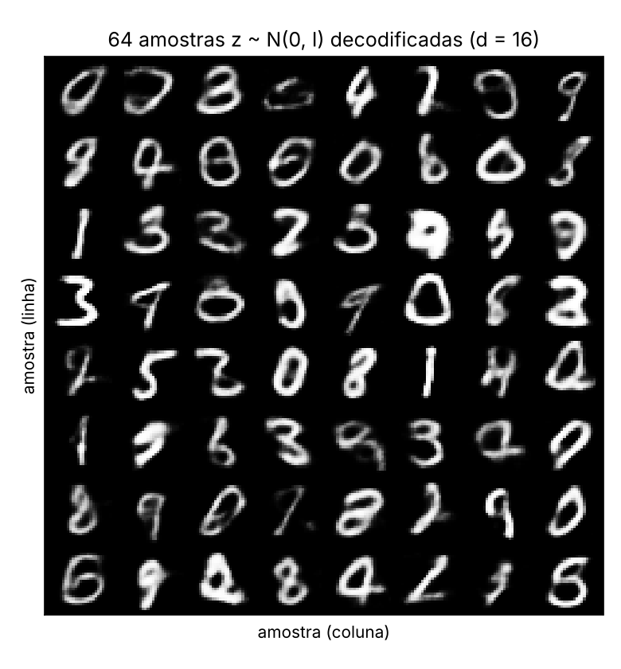
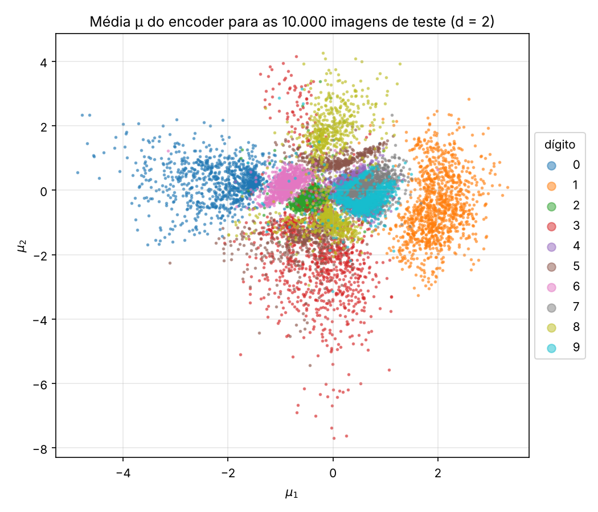
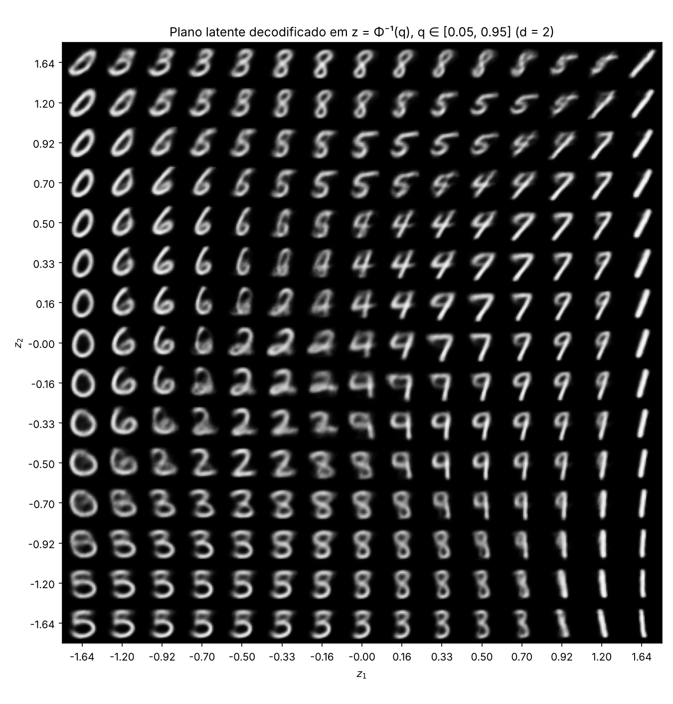
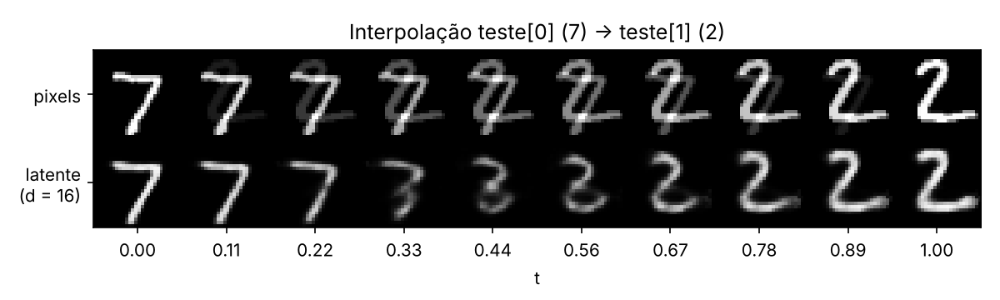

# 4. VAE

!!! abstract "Enunciado"

    [Exercises → VAE](https://insper.github.io/ann-dl/2026.2/exercises/vae/){:target='_blank'}

VAE no MNIST, escrito à mão em PyTorch (reparametrização, BCE + KL em forma fechada,
amostragem do prior; sem classes de VAE de biblioteca). Dois modelos, $d = 16$ e $d = 2$, com
$\beta = 1$ e a mesma receita: Adam $10^{-3}$, batch 128, 20 épocas, seed 42. Perdas em
**nats por imagem**. Teste só é usado no final.

| Teste | $d = 16$ | $d = 2$ |
|---|---|---|
| Reconstrução | 80,81 | 136,29 |
| KL | 20,25 | 6,75 |
| ELBO negativo | **101,06** | **143,04** |

??? example "Script completo — `code/vae_report.py`"

    ``` { .python .copy linenums='1' }
    --8<-- "docs/exercises/vae/code/vae_report.py"
    ```

    Para reproduzir: `cd docs/exercises/vae/code && python vae_report.py` (~4 min na CPU).

## Exercise 1 — VAE com $d = 16$

### Modelo e perda

Encoder 784 → 512 → 256 (ReLU) com duas cabeças ($\mu$ e $\log\sigma^2$), decoder
$d$ → 256 → 512 → 784 com sigmoid. A amostragem é $z = \mu + \sigma \odot \varepsilon$, com
$\varepsilon \sim \mathcal N(0, I)$, e a perda por imagem é

$$
\mathcal L(x) =
\underbrace{-\sum_{j=1}^{784}\big[x_j\log\hat x_j + (1-x_j)\log(1-\hat x_j)\big]}_{\text{reconstrução (BCE)}}
+
\underbrace{\tfrac12\sum_{k=1}^{d}\big(\mu_k^2 + \sigma_k^2 - 1 - \log\sigma_k^2\big)}_{\mathrm{KL}}
$$

``` { .python .copy }
--8<-- "docs/exercises/vae/code/vae_report.py:model"
```

### Treino


/// caption
**Figura 1** — Os dois termos da perda por época ($d = 16$).
///

A reconstrução despenca (172 → 80 nats) e a KL sobe de 7,5 para ~20 e estabiliza. Treino e
validação andam juntos, sem overfitting. No teste: **80,81 / 20,25**, dentro do esperado
(~81 / ~20).

### Reconstruções e amostras


/// caption
**Figura 2** — Em cima, um exemplo de teste por dígito; embaixo, a reconstrução de $\mu$.
///


/// caption
**Figura 3** — 64 amostras $z \sim \mathcal N(0, I)$ decodificadas.
///

### Análise

**Por que a KL sobe enquanto a perda total cai?** No início o encoder devolve
$\mu \approx 0$ e $\sigma \approx 1$ para qualquer imagem: KL baixa, mas código sem
informação e reconstrução péssima. Para reconstruir, ele precisa espalhar as médias e
encolher as variâncias, e isso afasta $q(z\mid x)$ do prior e custa KL. A troca compensa:
a reconstrução cai ~92 nats e a KL sobe só ~13.

**Por que a Figura 3 é pior que a 2?** Dois motivos. (1) A KL aproxima cada $q(z\mid x)$ do
prior, mas não garante que a união delas cubra o prior todo; sobram buracos onde o decoder
nunca viu nada, e amostras que caem ali viram híbridos ou borrões. (2) O decoder devolve a
*média* dos traços compatíveis com $z$, que é borrada quando $z$ está longe dos dados.

**Por que decodificar $\mu$ na Figura 2?** É o código mais provável da imagem; um $z$
sorteado acrescentaria ruído e a reconstrução mudaria a cada execução.

## Exercise 2 — VAE com $d = 2$

### Espaço latente


/// caption
**Figura 4** — $\mu$ do encoder ($d = 2$) nas 10.000 imagens de teste, colorido pelo dígito.
///


/// caption
**Figura 5** — Grade 15 × 15 decodificada em $z = \Phi^{-1}(q)$, $q \in [0{,}05;\,0{,}95]$.
///

A grade usa $\Phi^{-1}$ (quantis da normal) para que cada célula tenha a mesma massa de
probabilidade sob o prior; por isso o centro, onde o prior se concentra, é mais denso.

``` { .python .copy }
--8<-- "docs/exercises/vae/code/vae_report.py:ex2_grid"
```

### Interpolação

Teste[0] (um 7) → teste[1] (um 2), com $t$ em 10 passos: pixels, $(1-t)x_a + t x_b$, contra
espaço latente do modelo $d = 16$, decodificando $(1-t)\mu_a + t\mu_b$.


/// caption
**Figura 6** — Em cima, interpolação nos pixels; embaixo, no espaço latente ($d = 16$).
///

### Análise

**Quais dígitos se sobrepõem?** **4, 7 e 9** ocupam a mesma mancha perto de
$\mu \approx (0{,}5;\,0)$, e há mistura entre **3, 5 e 8** logo abaixo do centro. Na
Figura 5, um 4 aberto vai fechando o topo até virar 9, que achata até virar 7. Eles
compartilham a haste vertical e só diferem no topo; com 2 números o modelo não separa isso.

**O que 2 dimensões obrigam a descartar?** Quase tudo além de "qual dígito e qual
inclinação": espessura, o pé do 1, o corte do 7. Cada região vira um estilo médio, mais
borrado. Em números: KL cai 13,5 nats, mas a reconstrução piora 55,5 (80,8 → 136,3).

**As duas linhas da Figura 6.** A de pixels é um *cross-fade*: em $t = 0{,}5$ há um 7 e um 2
sobrepostos, porque a média de dois dígitos não é um dígito. A latente passa por formas
contínuas com cara de dígito (algo como um 3 em $t \approx 0{,}4$), pois o decoder transforma
a reta em $z$ num caminho sobre a variedade dos dígitos.

## Results summary

| # | Quantidade | Valor |
|---|---|---|
| 1 | Ex. 1: teste — reconstrução, KL e ELBO negativo ($d = 16$) | 80,81 · 20,25 · 101,06 |
| 2 | Ex. 1: KL de validação, primeira → última época | 13,10 → 20,21 |
| 3 | Ex. 2: teste — reconstrução e KL ($d = 2$) | 136,29 · 6,75 |
| 4 | Ex. 2: índices de teste interpolados | 0 (dígito 7) e 1 (dígito 2) |
